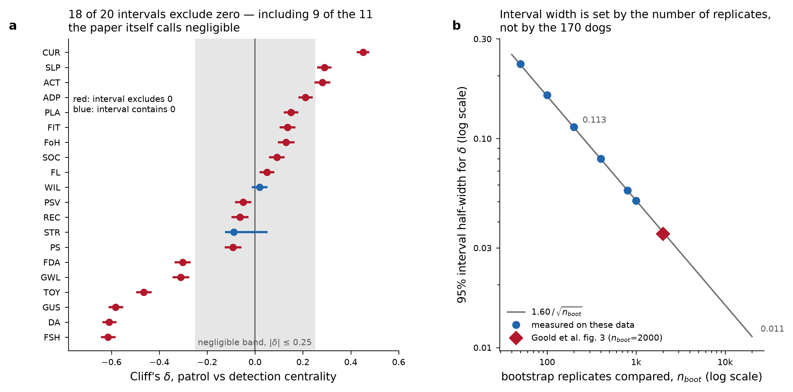
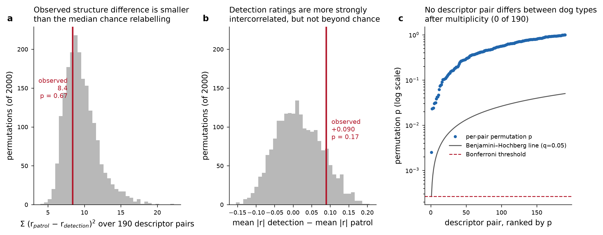
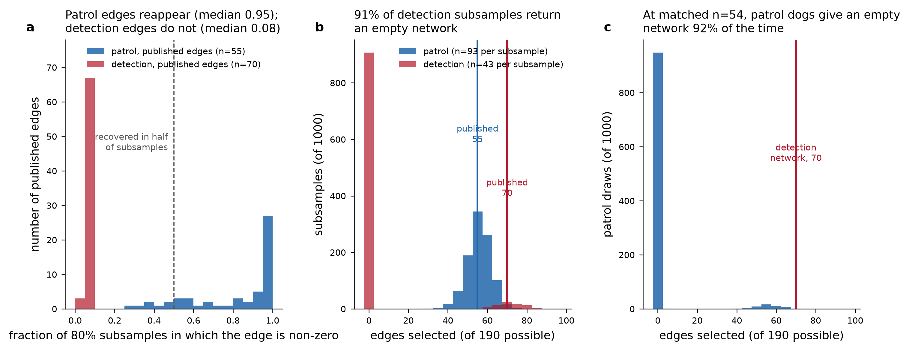
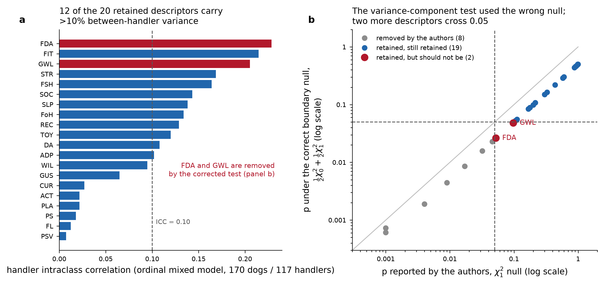

# Statistical review — Goold, Vas, Olsen & Newberry (2016)

**Paper.** Goold C, Vas J, Olsen C, Newberry RC. *Using network analysis to study behavioural
phenotypes: an example using domestic dogs.* Royal Society Open Science 3:160268.
doi:10.1098/rsos.160268

**Data reviewed.** The authors' full Dryad deposit — `rawData.csv`,
`finalMIdata_averaged_rounded.csv`, the patrol and detection GGM association matrices, the
complete `Rscript.R`, and the supplementary PDF (tables S1–S5, figures S1–S2). **Substitution
declared:** the deposit was retrieved from the Zenodo mirror of record 4967251 rather than
from `doi:10.5061/dryad.81k11` directly; every file named in the paper's Data Accessibility
statement is present in that mirror and all numbers below come from those files.

**Reproduction status.** Both published networks reproduce exactly from the deposited imputed
data: 55 patrol edges and 70 detection edges, edge sets identical to the deposited association
matrices at all 190 node pairs, maximum weight discrepancy 0.0060 (patrol) and 0.0000
(detection). Table S4 centralities reproduce to within rounding. Sample sizes reproduce
exactly: 170 dogs (116 patrol, 54 detection) from 117 handlers, of whom 44 submitted more than
one survey (35 with two dogs, 9 with three; mean 1.453 ± 0.636). The **bootstrap** stage does
not reproduce under current `qgraph`; see Limitations.

---

## 1. Verdict table

Machine-readable version: `claims_goold.csv`.

| id | claim (short) | design | test used | test indicated | reported p | recomputed p | effect + interval | verdict | sev |
|---|---|---|---|---|---|---|---|---|---|
| C1 | Networks "varied between dog types" | 116 vs 54 dogs, two separate GGMs | none (visual contrast) | permutation, handler-level label shuffle | none | **0.666** omnibus; 0.168 mean \|r\|; 0/190 pairs after BH | SS of polychoric differences 8.41 vs null median 9.21 | Mis-specified | A |
| C2 | "Bootstrap analyses revealed the stability of network results" | resampling of dogs | bootstrap, no criterion stated | edge-inclusion + centrality stability per network | none | n/a | patrol 48/55 edges recovered in ≥50% of 80% subsamples; detection **0/70**, 907/1000 subsamples empty | Contradicted | A |
| C3 | Most central descriptors are desirable, in both networks | 14 vs 6 nodes per network | none | none available (nodes are not independent) | none | not testable | P(superiority) 0.84/0.89 patrol, 0.63/0.80 detection | Supported, overstated | C |
| C4 | "Playful" is central and mediating in both networks | node centrality | rank of point estimate | rank-order stability (authors supply it) | none | n/a | patrol betweenness 106 (1st of 20); detection 100 and strength 1.321 (both 1st) | Supported | – |
| C5 | 55 edges (28.95%) patrol, 70 (36.84%) detection | EBICglasso, n=116 / n=54 | none | none for counts; densities at different n are not comparable | none | n/a | reproduced exactly; edge sets identical 190/190 | Supported | – |
| C6 | Named salient patrol edges | one GGM, n=116 | none (lasso selection) | edge-inclusion proportion | none | n/a | all reproduce; median inclusion 0.95 vs 0.08 for absent pairs | Supported | – |
| C7 | Named salient detection edges | one GGM, n=54 | none (lasso selection) | edge-inclusion proportion | none | n/a | all reproduce from the matrix, but median inclusion **0.08**; 0/70 reach 0.5 | Mis-specified | A |
| C8 | Desirable descriptors have higher observed centrality | 14 vs 6 nodes | none | none available | none | not testable | P(superiority) as C3 | Supported, overstated | C |
| C9 | ACT, CUR, FIT, REC, SLP higher in patrol on both metrics | point estimates, different n | none | none (descriptive) | none | n/a | exactly these 5 of 20; reproduced | Supported | – |
| C10 | DA, FSH, GUS, GWL, PS, PSV, STR, TOY higher in detection | point estimates, different n | none | none (descriptive) | none | n/a | exactly these 8 of 20; reproduced | Supported | – |
| C11 | CUR (δ=0.452), SLP (0.290), ACT (0.282) favour patrol | Cliff's δ on 2000×2000 bootstrap replicates | δ with 95% CI on replicates | permutation vs exchangeable labels + multiplicity | none (CI used as the test) | **0.666 / 0.168**; 0/190 after BH (min q=0.475) or max-stat FWER (min p=0.692) | CI half-width 0.0350 = 1.60/√n_boot — Monte-Carlo error; 18/20 intervals exclude 0 | Mis-specified | A |
| C12 | FSH (−0.614), DA (−0.609), GUS (−0.582), TOY (−0.465), GWL (−0.310), FDA (−0.302) favour detection | as C11 | as C11 | as C11 | none | as C11 | same interval defect; computed on a network that does not survive an 80% subsample | Mis-specified | A |
| C13 | Bootstrap edge-count SD 12.82 / 29.75 | 2000 bootstraps per network | descriptive SD | same | none | not reproducible | same code under qgraph 1.10.1 gives mean 149.6 (SD 41.2) and 147.1 (SD 16.3) edges | Not assessable | C |
| C14 | Node-wise bootstrapping shows "reasonable stability" | resampling of **nodes** | correlation with original centralities | resampling of the sampled unit (dogs) | none | n/a | node-wise resampling holds all 170 dogs fixed and cannot address sampling error | Supported, overstated | B |
| C15 | Subject-wise: patrol <~60 and detection <~40 dogs correlate poorly | subject-wise resampling | correlation with original | same | none | n/a | corroborated: 907/1000 43-dog detection subsamples empty; 924/1000 matched-n=54 patrol draws empty | Supported | – |
| C16 | CUR–SOC correlate pairwise (0.41, 0.40) but share no edge → "common mediating variables" | absence of an L1-shrunk edge | none (a lasso zero) | conditional-independence test or inclusion proportion | none | n/a | r reproduces at 0.414 / 0.397; edge present in 3.5% of patrol subsamples, 0.9% of detection (uninformative there) | Supported, overstated | B |
| C17 | Aggression descriptors more frequently/strongly **negatively** tied to desirable descriptors in detection than patrol | edge counts and weight sums | none | permutation on those edges | none | 0/190 pairs differ after BH or FWER | detection 4 negative edges (Σ −0.213) vs patrol **7** (Σ −0.315); detection also has 5 **positive** ones (Σ +0.350), patrol none | Contradicted | A |
| C18 | Eight descriptors removed for handler non-independence; remaining 20 treated as independent | 44 repeat handlers; clmm vs clm | LRT on a variance component referred to χ²₁, uncorrected over 29 tests | LRT referred to ½χ²₀+½χ²₁ | FDA 0.052, GWL 0.097 (retained) | **FDA 0.026, GWL 0.048** (both removed); 8 → 10 removals | handler ICC median 0.114, max 0.228; 12/20 > 0.10; design effect 1.048, n_eff 162/170 | Mis-specified | B |
| C19 | 15 imputations averaged and rounded to one dataset | 1.2 ± 1.03% missing | mean of imputations | Rubin's rules, or one imputation declared as such | none | n/a | discards between-imputation variance; magnitude small at ~1.2% missing | Mis-specified | C |
| C20 | γ=0.65 chosen as the largest value giving a non-empty detection graph | EBIC tuning | selection on an analysis outcome | a priori value or reported sensitivity over γ | none | n/a | detection network is at the estimator's detection boundary by construction; fully disclosed | Supported, overstated | B |
| C21 | Lasso gave "credibly non-zero partial correlations" | L1 inverse covariance | EBIC selection | no error-controlled statement is available | none | n/a | 190 edge parameters per network from 116 / 54 observations, no false-positive control | Supported, overstated | C |

Totals: 6 Supported, 6 Supported-overstated, 6 Mis-specified, 2 Contradicted, 1 Not assessable.
Severity A on 6 claims, B on 4, C on 5.

---

## 2. Summary

Three findings change how this paper should be read.

**First, the paper contains no inferential comparison between the patrol and detection
networks, and when one is supplied the comparison does not survive.** The entire comparative
argument — the abstract's "varied between dog types", the lists of differentially central
descriptors, and figure 3 — rests on Cliff's δ computed between two bootstrap distributions.
That statistic has no null distribution attached to it, and the 95% intervals drawn around it
in figure 3 are Monte-Carlo error: their width is 1.60/√n_boot, so it is set by how many
bootstrap replicates were run rather than by the 170 dogs. At n_boot = 2000 that half-width is
0.035, which is why 18 of 20 intervals exclude zero — including 9 of the 11 descriptors the
paper itself classifies as having negligible effect sizes. Supplying the missing reference
distribution by permuting dog type at the handler level gives p = 0.666 for the overall
difference in correlation structure, p = 0.168 for the difference in mean association strength,
and zero of 190 descriptor pairs surviving either Benjamini–Hochberg or a max-statistic
family-wise correction.

**Second, the detection-dog network is not estimable at n = 54 under the chosen settings.** In
1000 subsamples retaining 80% of the detection dogs, 907 returned a completely empty graph, and
not one of the 70 published detection edges reappeared in even half of the subsamples (median
inclusion 0.08). The patrol network behaves entirely differently: 48 of its 55 edges reappear in
at least half of equivalent subsamples, median inclusion 0.95. The cause is visible in the
methods — γ was set to 0.65 precisely because larger values emptied the detection graph, which
places that network at the estimator's detection boundary by construction. The abstract's
"bootstrap analyses revealed the stability of network results" is therefore true of the patrol
network and contradicted for the detection one, and every detection-specific edge claim and
centrality comparison inherits this.

**Third, one discussion claim reverses on the authors' own deposited matrices.** The statement
that aggression descriptors are "more frequently and strongly negatively correlated with
desirable descriptors" in the detection than the patrol network is the wrong way round: the
detection network has 4 such negative edges summing to −0.213 against the patrol network's 7
summing to −0.315, and it additionally carries 5 *positive* aggression–desirable edges where
patrol has none. The companion half of the sentence (aggression positively tied to other
undesirable descriptors) does hold.

Against this, much of the paper is sound and unusually transparent. The networks, centralities
and descriptive edge claims reproduce exactly from the deposit; the descriptor-reduction
pipeline (43 → 20) is disclosed step by step with its criteria; the γ choice is stated openly;
and §3.3 reports the subject-wise instability that my re-analysis confirms and sharpens. The
handler clustering that the design invites turns out to be real but small in consequence —
median ICC 0.114 across the retained descriptors, but only 1.453 dogs per handler, giving a
design effect of 1.048 and an effective n of 162 rather than 170. Nothing here turns on it.

---

## 3. Per-claim findings, in severity order

### Severity A

#### C11 / C12 — the intervals in figure 3 measure computing time, not evidence

*What was done.* For each of 20 descriptors, the 2000 patrol bootstrap centralities were
compared with the 2000 detection bootstrap centralities using Cliff's δ with a 95% confidence
interval (`effsize::cliff.delta`, `use.normal = FALSE`), separately for betweenness and
strength, then averaged. Descriptors with |δ| > 0.25 were read as showing a real between-network
difference.

*What it assumes.* That the interval around δ expresses uncertainty about the dog populations,
and that a δ computed between two resampling distributions is a statement about whether those
populations differ.

*Why that fails here.* Cliff's δ is being computed on n₁ = n₂ = n_boot pseudo-observations, so
its standard error scales as n_boot^(−1/2) and is a measure of Monte-Carlo noise, not of
sampling error in the 170 dogs. Measuring the same estimator on replicate distributions from
these data gives a half-width of 1.60/√n_boot, which at n_boot = 2000 predicts 0.0357 against the
published mean of 0.0350 (panel b below). The consequence is that 18 of the 20 published
intervals exclude zero, 9 of them belonging to descriptors the paper itself calls negligible;
running 20 000 instead of 2000 replicates would have shrunk every interval by a further factor
of about three without touching the data. Separately, δ itself has no reference distribution:
nothing in the analysis says how large δ would be if dog type carried no information. The paper
also reports in §2.5.3 that confidence intervals on bootstrapped parameters are not given
"due to known biases in their estimation", which is inconsistent with figure 3.

*What should have been done.* Compare the two networks against a null in which dog type is
exchangeable. Because dogs are nested in handlers, the label must be permuted at the handler
level. The statistic should be pre-specified, and the 20 descriptors × 2 metrics should be
handled by a max-statistic permutation correction rather than left uncorrected.

*What changes.* Supplying that test (2000 handler-level permutations; p-resolution 1/2001) gives
an omnibus p of 0.666 for the sum of squared differences in polychoric correlation across all
190 descriptor pairs — the observed difference, 8.41, is *smaller* than the permutation median
of 9.21. A targeted test of overall association strength gives mean |r| of 0.291 (patrol) against
0.380 (detection), a difference of +0.090 with permutation p = 0.168. Per pair, 11 of 190 reach
raw p < 0.05 against 9.5 expected by chance; none survives Benjamini–Hochberg (minimum q = 0.475)
or the max-statistic correction (minimum p = 0.692). The claims that specific descriptors are
differentially central between dog types are not supported by the data.

#### C2 / C7 — the detection network does not survive its own data

*What was done.* A Gaussian graphical model with an L1 penalty was fitted to the 54 detection
dogs, EBIC-tuned at γ = 0.65, yielding 70 edges; 19 specific edges are named in §3.1 and
interpreted in §4, and the abstract states that bootstrap analyses established the stability of
the network results.

*What it assumes.* That the selected edge set is identified at n = 54 — i.e. that a different
sample of detection dogs from the same population would yield recognisably the same graph.

*Why that fails here.* Re-estimating the network on 1000 subsamples retaining 80% of the
detection dogs (n = 43) returns a completely empty graph 907 times. Across all 1000, the median
inclusion proportion of the 70 published edges is 0.08 and not one edge reaches 0.5. The patrol
network under the identical procedure gives a median of 56 edges (published 55), zero empty
graphs, median inclusion 0.95 for its published edges against 0.08 for absent pairs, and 48 of
55 edges recovered in at least half of subsamples. The asymmetry is not a small-sample caveat;
it is the difference between a graph that is estimated and one that is at the edge of being
detected at all.

*What should have been done.* Report edge-inclusion proportions from the bootstrap (the standard
`bootnet` output) alongside figure 1, and decline to name individual detection edges that fall
below a stated inclusion threshold. Where the sample cannot support a sparse-graph estimate, say
so rather than reporting the point estimate.

*What changes.* Every detection-specific edge statement in §3.1 and every mechanism read off
them in §4 — the aggression cluster, the PLA–GUS negative link, the FSH hub — becomes a
description of one unstable fit rather than a finding about detection dogs. The patrol-network
statements are unaffected.

#### C1 — "varied between dog types" has no test behind it

*What was done.* Two networks were fitted separately and their edge counts, edge patterns and
centrality profiles compared by inspection; the abstract states that the conditional-independence
relationships varied between dog types.

*What it assumes.* That differences between two separately fitted sparse graphs reflect
differences between the populations rather than differences in estimation.

*Why that fails here.* The two networks were estimated from 116 and 54 observations with a
penalty whose EBIC term depends explicitly on n, so their densities are not on a common scale,
and the model-selection step is discontinuous: a small change in the correlation matrix flips
the detection graph between 70 edges and none. With dog type permuted at the handler level,
groups of detection size returned an empty graph in 322 of 400 draws, so even the omnibus
edge-count comparison is weakly resolved (observed 70 edges, one-sided p = 0.055). The one
comparison that does separate the groups — the detection sample yields 70 edges where matched
54-dog patrol draws yield an empty graph in 924 of 1000 and reach 70 edges only twice
(p = 0.002) — says the detection ratings are *more strongly intercorrelated overall*, not that
particular descriptors are differentially central. That overall-strength difference is itself
not significant under the correct handler-level permutation (p = 0.168).

*What should have been done.* A network comparison test: permute the group label at the level of
the sampled unit and compare a pre-specified invariance statistic (global strength, maximum edge
difference, or per-node centrality with a max-statistic correction).

*What changes.* The abstract sentence should read that the two fitted networks differ in
appearance, with no evidence that the underlying association structures differ; the quantified
difference that does emerge — stronger overall intercorrelation among detection ratings — is
suggestive (p = 0.168 by label permutation) rather than established.

#### C17 — the aggression contrast runs the other way

*What was done.* §4 states that in the detection network, aggression descriptors (DA, GWL, FDA)
were "more frequently and strongly negatively correlated with desirable descriptors and
positively correlated with undesirable descriptors compared to the patrol dog network", and reads
this as evidence of "less stringent behavioural selection criteria for detection dogs".

*What it assumes.* That the counts and magnitudes in the two deposited association matrices
support the stated direction.

*Why that fails here.* Counting the aggression-to-desirable edges in the deposited matrices:
patrol has 7, all negative, summing to −0.315; detection has 9, of which only 4 are negative
(Σ −0.213) and 5 are positive (Σ +0.350). On frequency the comparison reverses; on total
magnitude it also reverses; only the mean magnitude of the negative edges is marginally larger
in detection (0.053 vs 0.045). The second half of the sentence does hold — aggression
descriptors link positively to other undesirable descriptors with Σ +0.377 in detection against
+0.044 in patrol, and within the aggression trio Σ +0.702 against +0.502.

*What should have been done.* State the counts and sums, and test the specific edges by
permutation rather than comparing two unstable fits by eye.

*What changes.* The sentence must be rewritten: in the detection network aggression descriptors
are *less* uniformly negatively tied to desirable traits than in the patrol network, and they
cluster more strongly with other undesirable traits. The "less stringent selection criteria"
reading is still available from the second half, but the first half as written is contradicted
by the authors' own data — and no aggression-related pair survives multiplicity correction in
any case.

### Severity B

#### C18 — the handler-independence screen used the wrong null distribution

*What was done.* For each of 29 descriptors, an ordinal cumulative-link model with a handler
random intercept was compared with one without, on the subset of 44 handlers who rated more than
one dog. The likelihood-ratio statistic was referred to a χ² distribution with 1 degree of
freedom; eight descriptors reached p < 0.05 and were removed, and the remaining 20 were analysed
as independent observations.

*What it assumes.* That under the null the LRT statistic for dropping a variance component is
χ²₁ distributed.

*Why that fails here.* A variance component is bounded below by zero, so the null places the
parameter on the boundary of the parameter space and the correct reference distribution is the
mixture ½χ²₀ + ½χ²₁ (Self & Liang; Stram & Lee). The reported p-values are therefore twice their
correct values — verified by recomputing from the authors' own LR statistics in table S2, which
reproduce exactly as `pchisq(LR, 1, lower = FALSE)`. The test was also run on 44 handlers only,
which limits its power to detect the clustering it was screening for.

*What should have been done.* Refer the statistic to the boundary mixture, and treat a
non-significant result as absence of evidence rather than evidence of independence — or avoid
the screen entirely by fitting the networks with handler-level resampling.

*What changes.* Two further descriptors cross 0.05: FDA (0.052 → 0.026) and GWL (0.097 → 0.048),
both aggression descriptors that carry the detection-network aggression cluster and the GWL–FDA
edge named in both networks. Fitting ordinal mixed models to all 170 dogs confirms the retained
set is not clean: handler ICC has median 0.114 and reaches 0.228 (FDA), 0.215 (FIT) and 0.205
(GWL), with 12 of 20 descriptors above 0.10. The practical cost is nonetheless small — at 1.453
dogs per handler the design effect is 1.048, so the effective n is 162 rather than 170 (patrol
111, detection 52). The conclusion is that the reported independence of the retained descriptors
is overstated, not that the networks should be discarded on this ground.

#### C20 — γ was tuned on an outcome of the analysis

*What was done.* γ was varied across its range in steps of 0.05 and set to 0.65, described as
"the most conservative value", because values above it produced an empty detection graph.

*What it assumes.* That a tuning parameter selected by reference to the emptiness of one of the
fitted graphs still yields a graph whose edges can be interpreted as discoveries.

*Why that fails here.* The selection rule guarantees that the detection network sits at the
threshold of detectability: it is, by construction, the sparsest non-empty solution the data
admit. The subsampling result follows directly — 907 of 1000 80% subsamples, and 322 of 400
permutation draws of comparable size, return the empty graph that γ = 0.70 would have returned
on the full sample. The choice is disclosed, which matters; it is the interpretation that
over-reaches.

*What should have been done.* Fix γ a priori (0.5 is the common default) or present the
edge set as a function of γ, so the reader can see which edges are robust to the tuning.

*What changes.* No number changes, but the detection network's 70 edges should be read as the
most permissive summary the data allow rather than as a set of credible relationships.

#### C14 — node-wise bootstrapping cannot establish the stability that is claimed

*What was done.* Networks were re-estimated from random subsets of 3 to 19 of the 20 nodes, 2000
times, and the resulting centralities correlated with the originals; §3.3 reads the positive
correlations as demonstrating "reasonable stability of the original network structures".

*What it assumes.* That resampling nodes probes the same uncertainty as resampling dogs.

*Why that fails here.* Node-wise resampling holds all 170 ratings fixed. It measures how much a
centrality ranking depends on which descriptors were included in the survey, which is a question
about the instrument, not about sampling error. The uncertainty that matters for every claim in
§3.1–3.2 is the dog-sampling uncertainty, and the authors' own subject-wise analysis (C15)
reports that it is substantial.

*What should have been done.* Lead the stability section with the subject-wise and edge-inclusion
results and present node-wise bootstrapping as what it is, a sensitivity analysis to descriptor
selection.

*What changes.* "Reasonable stability" should be qualified to "stable under removal of
descriptors; unstable under removal of dogs for the detection network".

#### C16 — a lasso zero is not a conditional-independence result

*What was done.* CUR and SOC correlate pairwise at 0.41 (patrol) and 0.40 (detection) but share
no edge in either network; §4 reads this as showing their pairwise correlation is "due to common
mediating variables".

*What it assumes.* That an edge shrunk to zero by an L1 penalty reflects conditional independence
rather than insufficient evidence to retain the parameter.

*Why that fails here.* Lasso selection is a bias–variance compromise, not a test; its zeros carry
no error control, and at γ = 0.65 the estimator is tuned towards specificity, which shrinks true
weak edges to zero as readily as absent ones. No conditional-independence test was performed, and
"due to" is causal language applied to an observational survey with no randomisation.

*What should have been done.* Report the inclusion proportion for the specific edge, and phrase
the conclusion as consistency with mediation rather than demonstration of it.

*What changes.* For the patrol network the absence is in fact well supported — the CUR–SOC edge
appears in only 3.5% of 80% subsamples, against a median of 0.95 for the edges that are present —
so the empirical claim survives there. For the detection network it does not: the edge appears in
0.9% of subsamples, but 91% of those subsamples contain no edges at all, so its absence carries no
information. "In either network" should become "in the patrol network"; the mediation reading
remains a hypothesis.

### Severity C

#### C13 — the bootstrap edge-count SDs could not be reproduced

The reported SDs (12.82 patrol, 29.75 detection) come from a step I could not reproduce. Running
the authors' procedure under `qgraph` 1.10.1 — 2000 with-replacement resamples, `cor_auto`
polychoric matrices, `EBICglasso` at γ = 0.65 and fixed n — gives mean edge counts of 149.6
(SD 41.2) for patrol and 147.1 (SD 16.3) for detection, against published networks of 55 and 70
edges. The mechanism is visible: in 25 of 25 patrol resamples examined the polychoric matrix was
not positive definite and required smoothing, after which EBIC selected the minimum λ — a
near-complete graph — in roughly two thirds of cases. This is a toolchain difference, not
evidence that the authors' numbers are wrong, and it is why the stability re-analysis above uses
subsampling without replacement, which does not create the duplicate rows that trigger the
failure. Verdict is Not assessable rather than Contradicted.

#### C19 — averaging the imputations discards what multiple imputation is for

Fifteen Amelia imputations were averaged and rounded to a single integer dataset, which was then
analysed as if observed. The purpose of generating multiple imputations is to propagate
between-imputation variance into the final standard errors via Rubin's rules; averaging collapses
that variance to zero. With 1.2 ± 1.03% missing responses the magnitude is small and no claim in
the paper turns on it, but the procedure should either pool across imputations or use a single
imputation and say so.

#### C3 / C8 / C21 — wording that outruns the quantity computed

Three reporting defects, none of which changes a conclusion. "The most central descriptors
denoted desirable characteristics in both networks" holds comfortably for strength (probability
of superiority 0.89 patrol, 0.80 detection) but weakly for betweenness in the detection network
(0.63); no valid test is available because nodes within one network share edges and are not
independent units, and the sentence should be marked as descriptive. "Credibly non-zero partial
correlations" (§2.5.1) attributes an error-controlled guarantee to lasso selection, which
provides none — 190 edge parameters are selected per network with no false-positive control.

### Not a violation

Several features that a mechanical review would flag are appropriate here and are recorded as
such. The paper is explicit that its analyses are "primarily exploratory", and descriptive
reporting without p-values is not an error when no claim of difference is made (C5, C6, C9, C10).
Unequal group sizes are not in themselves a problem. The 43 → 20 descriptor reduction is large
but every step is disclosed with its criterion and the removed descriptors are listed in table S1.
The γ selection rule is stated openly rather than buried. Section 3.3 reports the subject-wise
instability that undercuts the paper's own comparative claims — the opposite of selective
reporting. No p-curve was computed: the results section reports no hypothesis tests, so there is
no family of p-values to screen, and the 29 screening tests in table S2 were used to *remove*
descriptors, a direction in which an uncorrected test is conservative rather than permissive.
The p-hacking risk signature in this paper is confined to the γ tuning (C20), and it is disclosed.

---

## 4. Limitations of this review

- **The bootstrap could not be reproduced.** `bootnet` 0.3 is no longer installable against
  current `qgraph`, and the authors' bootstrap tables (`bootTable*.csv`) are not part of the
  deposit — only the derived summaries in tables S4 and S5. Re-running the documented procedure
  under `qgraph` 1.10.1 produces bootstrap networks far denser than the published ones (above),
  so the published Cliff's δ values in table S5 could not be re-derived; the best agreement I
  obtained was r = 0.81 against the published deltas. Claims C11 and C12 are therefore judged on
  the *method* — which is fully specified in the deposited R script and in the published
  intervals — and not on a recomputation of δ. C13 is Not assessable for the same reason. All
  stability re-analysis here uses 80%-subsampling without replacement, declared as a substitution
  for the authors' with-replacement bootstrap; the two are not numerically comparable, and the
  substitution is conservative in that subsampling cannot create the ill-conditioned matrices
  that broke the with-replacement version.
- **No test of the sampling frame is possible.** 174 of 227 invited handlers responded and the
  resulting sample is self-selected; breed composition differs sharply between the two groups
  (91 of 116 patrol dogs are German shepherds, against 8 of 54 detection dogs), so dog type is
  entangled with breed, with training regime and with task. No permutation, bootstrap or Q-Q plot
  addresses this. Every between-type statement in the paper, and every between-type test in this
  review, is a statement about police dogs as sampled, not about patrol and detection dogs as
  populations — and the breed confound means even a significant difference could not have been
  attributed to working role.
- **Distributional assumptions were not separately diagnosed.** The analysis rests on polychoric
  correlations, which assume a bivariate normal latent variable under each pair of ordinal
  ratings. That assumption is untestable from 1–5 ratings with these sample sizes and is not
  assessed here; no Q-Q panel is informative for it. This is noted, not flagged.
- **Rater reliability is unmeasured.** The authors state that no checks of reliability or
  validity were conducted. Each dog was rated by one handler, so rater error cannot be separated
  from dog-level variation, and the handler ICCs reported here mix handler rating style with real
  differences between the dogs a handler works with.
- **Handler-level permutation is approximate.** One handler rated dogs of both types; for the
  permutation null each handler was assigned a single type by majority, which affects one of 117
  handlers.
- **Permutation resolution.** All permutation p-values reported here are bounded below by
  1/2001 (structure and strength tests, 2000 permutations) or 1/1001 (edge-count tests, 400–1000
  draws). No p-value smaller than those resolutions is claimed.
