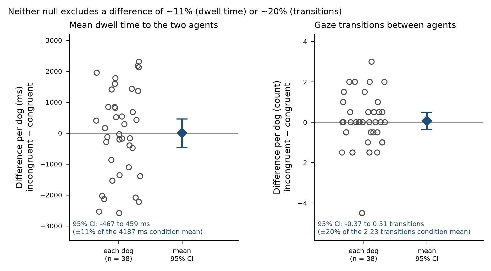
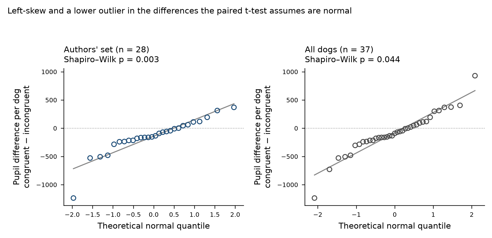
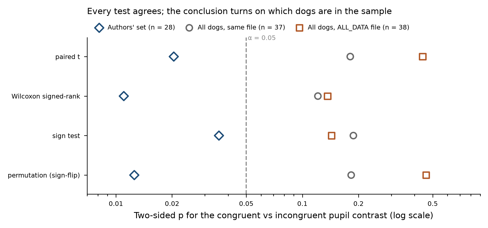

# Statistical review — Lonardo, Völter & Huber (2026)

**Paper.** Lonardo L, Völter CJ, Huber L (2026). *Pupil size changes reveal that dogs are
sensitive to the social conventions behind human gestures.* Cognition 274:106586.
doi:10.1016/j.cognition.2026.106586

**Material reviewed.** The publisher abstract, plus the authors' complete deposited data and R
analysis code (Zenodo 10.5281/zenodo.20066888): two eye-tracker interest-area reports, a
counterbalancing/demographics table, two down-sampled pupil sample reports (`…_ds.parquet`,
`…_ds_ALL_DATA.parquet`), and two R Markdown analysis files.

> **Coverage limit — read this first.** **The published full text is behind an Elsevier paywall
> and could not be retrieved.** No Methods section, no Results section, no figure, no table and
> no reported statistic from the paper was available to this review. Every claim below was
> extracted either from the abstract or by reconstructing the authors' own `.Rmd` analysis code,
> and the source is stated per claim. Consequently the **"reported p" column is blank for every
> row** and **no recomputed-versus-reported delta could be formed anywhere in this review**. All
> re-analysis is against the authors' deposited data and against their code as written; where
> the code and the abstract diverge, that divergence is itself reported. A reader with access to
> the published text should check the per-claim findings against what the paper actually says
> before acting on any of them.

**Design.** Within-subject eye-tracking study. Each dog watched up to four video trials, one per
condition. A communicating actress gestured "come here" (C) or "go away" (G); a second actress
then either approached (A) or walked away (G). The 2 × 2 crossing yields congruent trials
(CA, GG) and incongruent trials (CG, GA). **The experimental unit is the dog**, not the trial and
not the 100 ms eye-tracker sample.

---

## 1. Verdict table

| id | Claim (short) | Source | Design | Test used | Test indicated | Reported p | Recomputed p | Effect size + CI | Verdict | Sev |
|---|---|---|---|---|---|---|---|---|---|---|
| C1 | Looking time does not differ congruent vs incongruent | abstract + code | within-subject, unit = dog (39 dogs, 152 trials) | beta GLMM on proportion dwell time, `trial_type` LRT | same, or paired test on dog means | not visible | 0.987 (paired t, n=38); 0.897 (Wilcoxon) | −3.8 ms, 95% CI [−466.6, +459.0]; dz = −0.003 | Supported | C |
| C2 | Gaze transitions do not differ congruent vs incongruent | abstract + code | within-subject, unit = dog | Poisson GLMM, `log(trial dwell time)` offset, `trial_type` LRT | same | not visible | 0.763 (paired t, n=38); 0.603 (Wilcoxon) | +0.07 transitions, 95% CI [−0.37, +0.51]; dz = 0.049 | Supported | C |
| C3 | **Pupils dilate more for incongruent responses** (headline) | abstract + code | 41 samples/trial (100 ms, 1000–5000 ms) nested in trial nested in dog | GAMM (`mgcv::bam`, ML, discrete): `trial_type` + `s(time, by=trial_type)` + random smooths by dog and by trial | GAMM defensible; dog-level contrast must accompany it | not visible | did not complete in ≈2.4 h of fitting (see §4) | — (dog-level version is C4/C6) | Not assessable | C |
| C4 | Same contrast at the experimental unit: paired t on one mean per dog (n=28) | code | paired, unit = dog | paired t-test | paired t or Wilcoxon | not visible | **0.0204** (exact reproduction) | −141.6 baseline-corrected units, 95% CI [−259.5, −23.6]; dz = −0.466 | Supported | none |
| C5 | Same contrast by exact Wilcoxon, selected after a Shapiro–Wilk test | code | paired, unit = dog, n=28 | exact Wilcoxon signed-rank, chosen after Shapiro–Wilk p = 0.0027 | a test fixed before inspecting the differences, or both reported | not visible | **0.0110** (exact reproduction; V = 93, T⁺ = 313, 0 ties) | median paired difference −144.4 units | Supported | C |
| C6 | **The pupil finding characterises the N = 39 sample the abstract describes** | abstract (N=39) vs code (pupil analysis on 28 dogs) | paired, unit = dog | paired t / Wilcoxon on the 28 dogs with all four valid trials | same test on all dogs with both trial types, or an explicitly restricted claim | not visible | **0.181** (n=37, same file); **0.442** (n=38, authors' `ALL_DATA` file) | −81.3, 95% CI [−202.1, +39.5], dz = −0.224; −55.6, 95% CI [−200.3, +89.2], dz = −0.126 | **Contradicted** | **A** |
| C7 | Dogs look longer at the reacting than the communicating agent | code | paired, unit = dog, n=39 | paired t on dog means | same | not visible | 0.00122 | +1887.5 ms (5105.3 vs 3217.7 ms), 95% CI [+794.2, +2980.9]; dz = 0.560 | Supported | none |
| C8 | No trial-type × agent-type interaction on dwell time | code | within-subject 2 × 2, unit = dog | `drop1` LRT on the beta-GLMM interaction | same | not visible | 0.814 (per-dog difference-of-differences, n=38) | +180.2 ms, 95% CI [−1363.7, +1724.2] | Supported | none |
| C9 | Neither condition nor condition × agent type was significant | code (`.rmd` comment) | within-subject 4 × 2, unit = dog | omnibus LRT, full vs condition-free beta GLMM | omnibus **plus** the 1-df design-relevant contrast | not visible | 0.069 (Friedman across 4 conditions, n=37); **0.0088** for approach-vs-walk-away | agent preference 0.277 vs 0.060 of trial dwell time; difference 0.217, 95% CI [0.058, 0.375] (+2606 ms, 95% CI [+657, +4555]) | Supported, overstated | B |
| C10 | Expectations are context-specific — the same response surprises after one gesture but not the other | abstract | within-subject, 4 conditions | **no test in the deposited code**: the pupil model has no condition or response-type term | trial-type × response-type interaction, or the trial-type contrast within each response type | not visible | approach 0.209 (n=28) / 0.389 (n=33); walk-away 0.045 (n=28) / 0.142 (n=32); interaction 0.529 | approach −103.4, 95% CI [−268.4, +61.5]; walk-away −179.7, 95% CI [−355.0, −4.5]; interaction +76.3, 95% CI [−169.1, +321.8] | Supported, overstated | B |
| C11 | Eye movements insensitive while pupil size sensitive (a dissociation) | abstract | three outcomes, same dogs, same trials | significance of one outcome set against non-significance of two others | a measure × trial-type comparison, or an explicit statement that the dissociation was not tested | not visible | not computable as one test (non-commensurable scales) | dz = −0.47 (pupil, n=28) vs −0.003 and 0.049 (n=38); the two null CIs do not exclude an effect of the pupil contrast's standardised size | Supported, overstated | B |
| C12 | Expectations are "not self-centred" (third-party interaction) | abstract | third-party design; no dog-directed comparison condition | none (interpretive claim) | a dog-directed comparison condition | n/a | n/a | n/a | Not assessable | C |

Machine-readable version: `claims_lonardo.csv`.

---

## 2. Summary

**Three findings change how this paper should be read.**

**First, and decisively: the headline pupil effect is present only in the 28-dog subset the
authors analysed, and the abstract reports N = 39.** The authors' pupil code drops eleven named
dogs — exactly those missing at least one of the four conditions — and then runs the analysis on
the 28 that remain. That analysis reproduces exactly (paired t p = 0.0204; exact Wilcoxon
p = 0.0110). Run the authors' own pipeline on every dog in the same data file, the effect
disappears (n = 37, p = 0.181); run it on the authors' own `ALL_DATA` file, it disappears further
(n = 38, p = 0.442). The nine excluded dogs that contribute both trial types shift the pupil
contrast in the *opposite* direction (mean +106.2 against the included dogs' −141.6). The
exclusion rule itself is defensible and outcome-independent as written — completeness, not
outcome — but it is doing all of the work, and the abstract's "N = 39" does not describe the
sample in which the effect holds.

**Second, the two null claims are reported without the precision statement they need.** The
looking-time and gaze-transition nulls are real nulls, correctly analysed at the level of the dog
— but at n = 38 the 95% CI for the dwell-time difference is ±463 ms on a 4187 ms condition mean
(±11%), and for transitions ±0.44 on a mean of 2.23 (±20%). "Did not differ significantly" is the
correct wording and the authors use it; the abstract then leans on those nulls to assert a
*dissociation* between measures, which is a stronger claim than two non-significant tests can
carry and which was never tested as a contrast between measures.

**Third, a low-level visual confound survives the authors' omnibus test but not a targeted one.**
The dogs' preference for the reacting agent is 4.6× stronger when that agent *approaches*
(0.277 of trial dwell time) than when she *walks away* (0.060); difference 0.217, 95% CI
[0.058, 0.375], p = 0.009. The authors' 3-df omnibus condition × agent-type LRT was read as
"neither condition nor its interaction with agent type were significant", and a Friedman across
the four conditions reproduces that reading (p = 0.069). The design protects the *headline*
contrast from this confound — congruent and incongruent trials each contain one approaching and
one walking-away response — and that balance deserves credit. But the omnibus null should not be
read as evidence that where the dogs looked was unaffected by what the reacting agent physically
did.

Set against those: the paper's descriptive statistics reproduce to the decimal from the deposited
files, the experimental unit is handled correctly throughout (dog-level random effects in every
model; trials nested inside dogs in the GAMM via `s(time, Event, bs='fs')`), the Poisson
transition model carries the right exposure offset, bootstrap CIs and model-stability checks are
run on both GLMMs, and the pupil contrast is robust to *test* choice at every sample size — it is
sample composition, not test selection, that moves it. This is a carefully executed analysis with
one disclosure problem at its centre.

---

## 3. Per-claim findings, in severity order

### C6 — The pupil finding does not hold in the N = 39 sample the abstract names · *Contradicted* · **Severity A**

**What was done.** `non_verbal_communication_pupil_size_analysis.Rmd` begins by filtering out
eleven dogs — Ace, Filou, Floki, George, Ignaz, Jimi, Lenny, Sahibu, Sheila, Timo, Zserbo —
with the inline comment *"include only dogs with all 4 valid trials (1 per condition)"*, leaving
28. Every pupil analysis in the file, including the subject-level paired t-test and the exact
Wilcoxon, runs on those 28. The abstract reports the study as "an eye-tracking study (N = 39)".

**What it assumes.** That the 28-dog subset supports a statement about the population the N = 39
sample was drawn from — i.e. that completeness of the four-condition set is unrelated to the
pupil contrast.

**Why that fails here.** It is not unrelated. Reproducing the authors' pipeline exactly on their
own files:

| Sample | n | Mean congruent − incongruent | 95% CI | dz | paired t | exact Wilcoxon |
|---|---|---|---|---|---|---|
| Authors' set (all four trials valid) | 28 | **−141.6** | [−259.5, −23.6] | −0.466 | **0.0204** | **0.0110** |
| All dogs in the same file | 37 | −81.3 | [−202.1, +39.5] | −0.224 | 0.181 | 0.121 |
| All dogs, authors' `ALL_DATA` file | 38 | −55.6 | [−200.3, +89.2] | −0.126 | 0.442 | 0.136 |

The nine excluded dogs that contribute both trial types have a mean difference of **+106.2**, the
opposite sign. The exclusion is therefore not a neutral tidying step: it is the step that makes
the effect significant.

Two things should be said in the authors' favour. The rule is defined on data completeness, not
on the outcome, and it is applied before any test in the script — this is not an outcome-driven
exclusion. And it has a principled rationale: a dog missing, say, condition CA contributes a
walking-away trial to the congruent mean but both response types to the incongruent mean, so its
within-dog contrast is unbalanced for response type. That rationale does not rescue the claim
here, however, because response type has no measurable effect on pupil size in these data
(approach −66.8 vs walk-away −55.4; difference −11.4, 95% CI [−132.9, +110.1], p = 0.85, n = 28).
The imbalance the exclusion guards against is not the reason the effect vanishes without it.

**What should be done.** Report the exclusion and its consequence in the abstract and results:
state that the pupil analysis is on 28 of 39 dogs, give the completeness rule, and give the
all-dogs result alongside. If the 28-dog analysis is the pre-registered primary, say so and
present the N = 37/38 result as the sensitivity analysis it is.

**What changes.** The abstract sentence "with an eye-tracking study (N = 39) … their pupil size
changes did [differ]" becomes false as a description of a single analysis. The defensible version
is: *in the 28 dogs with a complete four-condition set, pupils dilated more on incongruent trials
(dz = −0.47, p = 0.02); across all 37–38 dogs with both trial types the difference is in the same
direction but not distinguishable from zero (dz = −0.13 to −0.22).* That is a materially weaker
and considerably more interesting claim.

---

### C9 — The omnibus condition test hides a large approach-versus-walk-away effect on gaze · *Supported, overstated* · **Severity B**

**What was done.** A beta GLMM with `condition * agent_type` was compared by LRT against a
condition-free model; the script records *"neither condition nor its interaction with agent type
were significant"*.

**What it assumes.** That a non-significant 3-df omnibus test licenses the conclusion that gaze
allocation between the two agents is unaffected by which condition was shown.

**Why that fails here.** The four conditions are not an unordered set. They cross *gesture* with
*response*, and the response factor — does the reacting agent walk toward the camera or away from
it — is a large, physically obvious visual difference. Collapsing the omnibus into that 1-df
contrast at the dog level, on the authors' own dependent variable (proportion of trial dwell
time):

- agent preference (reacting − communicating) after an **approaching** response: **0.277**
- after a **walking-away** response: **0.060**
- difference **0.217**, 95% CI [0.058, 0.375], paired t p = 0.0088, Wilcoxon p = 0.0072, n = 37
- in milliseconds: **+2606 ms**, 95% CI [+657, +4555], p = 0.010

A Friedman test across the four conditions on the same quantity gives p = 0.069 — consistent with
the authors' omnibus reading, and a textbook illustration of an omnibus test spreading one real
1-df effect across three.

This contrast was chosen from the design (approaching and receding figures differ in retinal size
and motion direction), not by scanning p-values, but it was chosen after the data were in hand
and should be counted as exploratory and as one more test in the family.

**What should be done.** Report the response-type contrast explicitly, and state that the
headline trial-type contrast is protected from it by design: congruent trials are {CA = approach,
GG = walk away} and incongruent trials are {GA = approach, CG = walk away}, so response type is
balanced within each level of trial type.

**What changes.** "Condition did not matter" becomes "the four-way condition test was
under-powered against a specific large effect: dogs track an approaching reactor much more
closely than a departing one, and the congruent/incongruent contrast is balanced with respect to
this." That protection is a design strength the paper can claim only once the confound is named.

---

### C10 — "Context-specific" is asserted for both gestures but demonstrated for one · *Supported, overstated* · **Severity B**

**What was done.** The abstract states that the expectations "are context-specific, as the same
responses elicited surprise following one gesture but not the other". The deposited pupil model
contains `trial_type` and `session_number` only — no condition term, no response-type term, no
interaction. The claim is therefore carried by the definition of `trial_type` rather than by a
test that resolves it.

**What it assumes.** That a pooled congruent-versus-incongruent effect implies the effect is
present within each response type — i.e. that *approaching* is surprising after "go away" and
that *walking away* is surprising after "come here".

**Why that fails here.** Decomposed at the dog level:

| Response type | Contrast | n | Mean difference | 95% CI | p |
|---|---|---|---|---|---|
| Approaching | CA (cong) − GA (incong) | 28 | −103.4 | [−268.4, +61.5] | 0.209 |
| Approaching | CA − GA | 33 | −66.4 | [−221.1, +88.3] | 0.389 |
| Walking away | GG (cong) − CG (incong) | 28 | −179.7 | [−355.0, −4.5] | 0.045 |
| Walking away | GG − CG | 32 | −127.9 | [−301.2, +45.4] | 0.142 |
| Interaction | (CA−GA) − (GG−CG) | 28 | +76.3 | [−169.1, +321.8] | 0.529 |

Both halves point the same way, and there is no evidence that they differ (interaction p = 0.53),
so nothing here contradicts context-specificity. But the approaching-response half, which is the
half the abstract's parenthetical leads with ("approaching after the 'go away' gesture"), is not
individually distinguishable from zero in either sample. The claim is supported in aggregate and
unresolved in each half.

**What should be done.** Either fit the response-type term and report the interaction, or state
that the design was powered for the pooled contrast only and that the within-response-type
decomposition is underpowered.

**What changes.** "The same responses elicited surprise following one gesture but not the other"
becomes "pooled across both response types, incongruent responses produced larger pupil dilation;
the two response types did not differ detectably from one another, and neither reaches
significance alone."

---

### C11 — The dissociation between measures was never tested as a contrast · *Supported, overstated* · **Severity B**

**What was done.** Looking time and gaze transitions were tested and found non-significant; pupil
size was tested and found significant; the abstract presents this as eye movements being
insensitive while pupil size is sensitive.

**What it assumes.** That "significant here, not significant there" establishes that the two
measures respond differently. It does not: the difference between a significant and a
non-significant result is not itself significant, and no test comparing the measures was run.

**Why that fails here.** The three outcomes sit on non-commensurable scales (ms, counts,
baseline-corrected pupil units), so a single contrast is not available without standardisation.
On standardised effect sizes the gap is dz = −0.47 (pupil, n = 28) against −0.003 (dwell) and
+0.049 (transitions, n = 38) — but the dwell and transition confidence intervals are wide enough
in standardised terms that neither excludes an effect of the pupil contrast's size, and the pupil
estimate itself is the one that does not survive the full sample (C6).

**What should be done.** Either standardise the three outcomes and test measure × trial type in
one model, or state plainly that the pattern is a difference in *evidence*, not a demonstrated
difference in *sensitivity*.

**What changes.** "Looking times did not differ … their pupil size changes did" is accurate as a
description of three test outcomes. The inference the discussion draws from it — that pupillometry
detects something the gaze measures cannot — is not supported by these data at this n.

---

### C1, C2 — Null claims reported without a precision statement · *Supported* · **Severity C**

**What was done.** Looking time was modelled with a beta GLMM on the proportion of trial dwell
time directed at the two agents, with `trial_type`, `agent_type`, `z.trial` and by-dog random
intercepts and slopes; gaze transitions with a Poisson GLMM carrying a `log(trial dwell time)`
offset and by-dog random intercepts and a trial-number slope. Both `trial_type` terms were
non-significant. Bootstrap CIs (1000 resamples) and model-stability checks were run on both.

**What it assumes.** Nothing problematic — these are correctly specified for the design. The
experimental unit is the dog in both models, the offset is the right exposure for a count of
transitions, and the beta family suits a bounded proportion. Dropping the non-significant
interaction before testing main effects (C8) is conventional and the interaction is nowhere near
threshold at the dog level (p = 0.814).

**Why the reporting still falls short.** The abstract's "did not differ significantly" is the
correct hedged wording, and under §8 of the review rule set a null reported with an interval is
not a violation. The interval is the issue: without it, a reader cannot tell what size of effect
the study ruled out. Recomputed at the dog level, n = 38:

- dwell time: **−3.8 ms**, 95% CI [−466.6, +459.0] — half-width ±11.1% of the 4187 ms condition mean
- transitions: **+0.07**, 95% CI [−0.37, +0.51] — half-width ±19.7% of the 2.23 condition mean

**What should be done.** Report both intervals in the text beside the LRT p-values, and state the
smallest effect the design could have detected. If equivalence is intended, pre-state a margin and
test against it.

**What changes.** Nothing about the verdicts; the nulls stand. What changes is how much weight
C11's dissociation argument can bear: a measure that could have missed a 20% change in gaze
transitions is not demonstrated to be insensitive to the manipulation.

---

### C5 — The test was selected by a normality test on the data being tested · *Supported* · **Severity C**

**What was done.** A paired t-test was run; a Shapiro–Wilk test on the difference scores followed
under the heading "Assumptions violated? --> Yes" (W = 0.872, p = 0.0027); an exact Wilcoxon
signed-rank test was then run and is the one reported in the script's final chunk.

**What it assumes.** That a normality test is a valid selector between parametric and
nonparametric tests.

**Why that fails here.** Conditioning the choice of test on the data distorts the error rate —
it is a forking path, and at n = 28 Shapiro–Wilk has enough power to reject departures the
t-test tolerates perfectly well. The differences are left-skewed with one dog at −1220, which is
visible in the Q-Q plot; this is exactly the shape where the t-test is mildly conservative rather
than invalid.

**What should be done.** Fix the test in advance from the design and the expected shape, and
report the other tests as sensitivity analyses rather than as replacements.

**What changes.** Nothing substantive: all four candidate tests agree at every sample size.

Within the 28-dog sample: paired t 0.0204, exact Wilcoxon 0.0110, sign test 0.0357, sign-flip
permutation (20,000 permutations) 0.0125. All four survive Benjamini–Hochberg across themselves
(q = 0.025–0.036); only the Wilcoxon survives Bonferroni (0.044). The minimum attainable sign-test
p at n = 28 is 7.5 × 10⁻⁹, so the design could easily have produced a significant result — this is
not a case where the test was incapable of rejecting.

---

### C3 — The headline GAMM could not be refit · *Not assessable* · **Severity C**

**What was done.** The pupil claim's primary analysis is
`bam(pupil_base ~ trial_type + session_number + s(time, k=20) + s(time, by=trial_type, k=20) +
s(Xgaze_RIGHT, Ygaze_RIGHT) + s(time, subject, bs='fs', m=1) + s(time, Event, bs='fs', m=1),
discrete=TRUE, method="ML")`, fitted twice: once on the 28-dog subset and once on all 39 dogs
with the `ALL_DATA` file.

**What it assumes.** That the nesting of 41 time samples inside each trial inside each dog is
absorbed by the two factor-smooth random terms, and that the parametric `trial_type` coefficient
and the `s(time, by=trial_type)` smooth are then valid tests of the condition difference.

**Why it could not be checked.** Two problems compound. The published statistic is not visible, so
there is no number to reproduce. And the model did not converge within the compute available: the
authors' exact call ran 95 minutes without returning, and an `fREML` variant ran a further
29 minutes, in two separate R installations (the second R environment's freshly built `mgcv`
crashed on load with a Mingw-w64 relocation failure). Nothing is reported for this row because
nothing was computed for it — the alternative would be to substitute a simpler model and present
its p-value as the authors', which this review will not do.

One specification point can be made from reading the code alone, and it is favourable: `Event` is
`subject × condition × session`, i.e. the trial, so `s(time, Event, bs='fs')` nested inside
`s(time, subject, bs='fs')` gives trial-level and dog-level random smooths. The nesting is handled.
Two points cannot be resolved without the fit: the residual autocorrelation of 100 ms-sampled
pupil traces (the script computes `acf(resid(...))` and saves the plot, but no `rho`/`AR.start`
argument appears in either `bam` call, so if the residual ACF is high the parametric `trial_type`
p-value is anti-conservative), and whether the two fitted versions — 28 dogs and 39 dogs — agree,
which given C6 is the question that matters most.

**What should be done.** Report both GAMM fits with their `trial_type` terms side by side, report
the residual ACF, and either justify the absence of an AR1 term or refit with one.

**What changes.** The dog-level analysis in C4/C6 is the correct-unit summary of the same
contrast and does not depend on the GAMM. If the GAMM's 39-dog fit also shows no `trial_type`
effect, C6's verdict extends to the headline analysis; if it does, the paper should explain why
the sample-level model and the dog-level model disagree.

---

### C4, C7, C8 — Reproduce exactly · *Supported* · **Severity none**

The reconstruction of the authors' dwell-time pipeline from the raw interest-area reports
(including the Zserbo frame-579 substitution, the three repeated sessions dropped by name, and the
`Georgia1`/`Mathild1` label recoding) reproduces their inline comments to the decimal:
mean dwell time to the reacting agent **5105.282 ms** and to the communicating agent
**3217.737 ms** (the script's comments record 5105.282 and 3217.737). 39 dogs, 152 trials, two
interest areas per trial, 18 females. The paired contrast is +1887.5 ms, 95% CI [+794.2, +2980.9],
t(38) = 3.495, p = 0.0012, dz = 0.56 — a large, robust effect, correctly analysed at the dog level.
The C4 pupil pipeline likewise reproduces exactly (n = 28, means −131.91 and +9.67, t(27) = −2.463,
p = 0.0204). The interaction dropped in C8 is nowhere near threshold.

A note on direction for C4, which the abstract's wording does not make visible: both condition
means are relative to each trial's own baseline, and the congruent mean is **−131.9** while the
incongruent mean is **+9.7**. The contrast is driven mainly by *constriction on congruent trials*
rather than dilation on incongruent ones. "Pupils dilated more when watching the incongruent
responses" is correct as a between-condition statement and potentially misleading as an absolute
one.

---

### C12 — "Not self-centred" · *Not assessable* · **Severity C**

The third-party framing is a property of the design, not of a statistic: there is no dog-directed
comparison condition against which self-centred and non-self-centred expectations could be
distinguished. The claim is an interpretation of what the dogs watched, and it is reported here as
having no inferential content to check rather than as either supported or failed.

---

## 4. Limitations of this review

1. **The published text was unavailable.** This is the dominant limitation and it bounds
   everything above. No Methods, Results, figure, table, reported statistic, stated n-per-analysis,
   pre-registration reference or exclusion rationale from the paper was readable. Claims C1–C3,
   C10–C12 were extracted from the abstract; C4–C9 were reconstructed from the authors' `.Rmd`
   files and are attributed to *the code*, which is not the same thing as attributing them to the
   paper. **No reported-versus-recomputed delta exists anywhere in this review**, which is normally
   the first check the re-analysis protocol asks for. Several findings above — particularly C6's
   severity and C10's and C11's over-statement verdicts — would soften if the paper already
   discloses what the code implies. A reviewer with the full text should re-run this register
   against it.
2. **The authors' GAMM, their primary pupil analysis, could not be refit** (see C3): ≈2.4 h of
   fitting across two R environments produced no converged model. Its `trial_type` terms, its
   residual autocorrelation and the 28-versus-39-dog comparison within the GAMM framework are all
   unresolved.
3. **The two GLMMs were not refit.** The beta GLMM (`glmmTMB`) and Poisson GLMM (`lme4`) behind C1,
   C2, C8 and C9 were read and judged on specification, and their claims were re-tested with
   dog-level paired tests on the same reconstructed data. Those are the correct-unit tests but they
   are not the authors' models: they ignore the trial-number covariate, the random slopes and the
   exposure offset, and they do not reproduce the authors' χ² and p-values.
4. **The deposited repository is incomplete for exact reproduction.** The `.Rmd` files load
   `./workspaces/dwell_time_react_IP.RData` and write model output tables to `./saves/`; neither
   directory is in the deposit. The authors' own numeric model output therefore could not be read
   even where the models themselves were not refit.
5. **Sampling and confounding are untouched by any of this.** The dogs are pet dogs recruited to a
   Vienna eye-tracking laboratory; the population the results generalise to is pet dogs of that
   recruitment channel, and no computation in this review can speak to that. Likewise, the video
   stimuli, the actresses, the gesture rendering and the counterbalancing were not inspected — the
   counterbalancing file records condition order per dog, but whether order was randomised and
   whether coders were blind cannot be established without the Methods.
6. **The response-type contrast in C9 is exploratory.** It was formed from the design rather than
   from a p-value scan, but it was formed after seeing the data, and it is one more test in a
   family that already contains at least a dozen reconstructable tests with no correction applied
   anywhere.
7. **Multiplicity could only be counted, not corrected, for the paper as a whole.** The
   reconstructable tests behind the pupil claim alone number six — two GAMMs × two terms each, plus
   the paired t and the exact Wilcoxon — all addressing one hypothesis on one dataset. This is not
   multiple hypotheses needing FDR control; it is multiple analyses of one hypothesis, which calls
   for disclosure of all of them rather than a correction. Whether the paper discloses all six
   could not be determined.
8. **No p-curve was run.** With fewer than ten reconstructable significant p-values, and most of
   them recomputed by this review rather than reported by the authors, a p-curve would describe
   this review's analysis choices rather than the paper's.
9. **Assumption diagnostics beyond those the authors ran, and beyond the Q-Q panels needed for
   C5, were not computed.**
