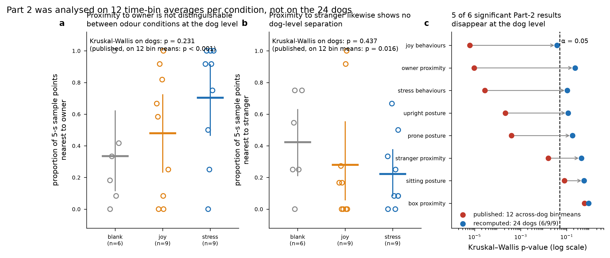
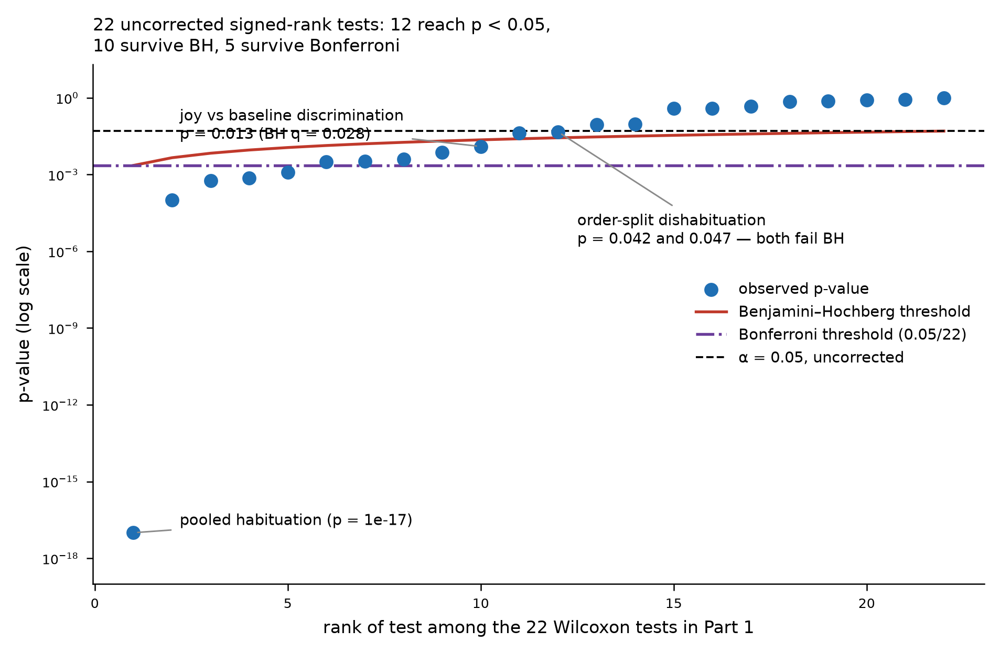
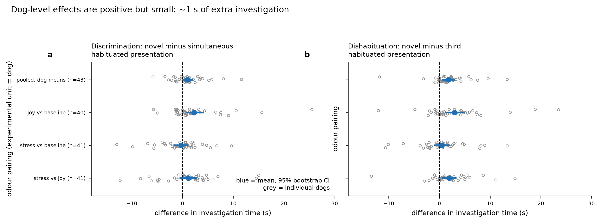

# Statistical review — Wang & Horowitz (2026), *Dogs (Canis familiaris) distinguish conspecific emotional chemosignals*

*Scientific Reports* 16:11176 · doi:10.1038/s41598-026-41426-1
Data reviewed: the authors' complete Dryad deposit (doi:10.5061/dryad.bzkh189pt) — `Part_1.xlsx`,
`Part_2.xlsx`, `README.md`, `statistical_analyses.R`. Every published statistic in both parts was
re-run from the deposit before any judgement was formed; **all of them reproduce**, once two R
conventions are matched (see §4): R's Gaussian-GLM AIC counts the dispersion parameter, and R's
`summary.glm` p-values for that family are t-based, not z-based.

---

## 1. Verdict table

| ID | Claim (short) | Design | Test used | Test indicated | Reported p | Recomputed p | Effect size + CI | Verdict | Sev |
|---|---|---|---|---|---|---|---|---|---|
| C1 | Investigation time fell from 1st to 3rd presentation (habituation) | paired, pooled over 3 pairings/dog | Wilcoxon signed-rank, n=122 trials | signed-rank on 43 dog-level means (or LMM with dog random effect) | V=7108, p<0.001 | p=9.9e-18 as run; p=2.5e-11 at dog level | -4.90 s mean decrease, 95% CI [-5.94,-3.90] (dog level) | Supported | C |
| C2 | Dogs investigated the novel odour longer than the simultaneous 4th habituated presentation (discrimination) | paired, pooled over pairings | Wilcoxon signed-rank, n=122 trials | signed-rank on 43 dog-level means | V=2704, p=0.008 | p=0.0075 as run; p=0.026 at dog level | +1.00 s, 95% CI [0.17,1.92] (dog level) | Supported, overstated | B |
| C3 | Dogs investigated the novel odour longer than the 3rd habituated presentation (dishabituation) | paired, pooled over pairings | Wilcoxon signed-rank, n=122 trials | signed-rank on 43 dog-level means | V=2061.5, p<0.001 | p=1.0e-4 as run (V=2061); p=1.2e-5 at dog level | +1.77 s, 95% CI [0.68,2.83] (dog level) | Supported | C |
| C4 | No dishabituation caused by the one-box to two-box format change | paired, pooled | Wilcoxon signed-rank | equivalence test against a pre-stated margin | V=2977, p=0.087 | p=0.087 | median paired diff -0.49 s; no interval reported | Supported, overstated | B |
| C5 | Discrimination in the joy vs baseline pairing | within-dog paired, n=40 dogs | Wilcoxon signed-rank | same | V=226, p=0.013 | p=0.0125; BH q=0.028 over 22 Part-1 tests; Bonferroni p=0.28 | median novel-habit4 +0.65 s | Supported | C |
| C6 | Dishabituation in the joy vs baseline pairing | within-dog paired, n=40 | Wilcoxon signed-rank | same | V=133, p<0.001 | p=5.9e-4; BH q=0.004 | median +1.93 s | Supported | none |
| C7 | Discrimination occurred 'only in the joy versus baseline condition' (null for stress-baseline and stress-joy) | within-dog paired | Wilcoxon signed-rank | equivalence test or interval | SB V=412 p=0.820; SJ V=301 p=0.095 | SB p=0.818; SJ p=0.095 | SB median +0.57 s; SJ median +1.29 s - both intervals compatible with real effects | Supported, overstated | B |
| C8 | Joy-baseline discrimination when joy was habituated (p=0.004) but not when baseline was habituated (p=0.470) | order subgroups, n=19 and n=21 | Wilcoxon signed-rank | order x phase interaction test, pre-specified | V=26 p=0.004; V=94 p=0.470 | p=0.0039 and p=0.473 | median +1.38 s vs +0.24 s | Mis-specified | B |
| C9 | Dishabituation to joy-baseline in both presentation orders | order subgroups, n=19 and n=21 | Wilcoxon signed-rank | same, BH-corrected | V=25 p=0.003; V=44 p=0.042 | p=0.0033 (BH q=0.011); p=0.042 (BH q=0.084) | median +2.70 s and +1.62 s | Supported, overstated | B |
| C10 | Discrimination between stress and joy when stress was habituated and joy novel | order subgroup, n=20 | Wilcoxon signed-rank | same, counted into multiplicity | V=23, p=0.001 | p=0.0012; BH q=0.005; Bonferroni p=0.027 | median +2.44 s | Supported | C |
| C11 | Dishabituation between stress and joy (overall and both orders) | paired, pooled and order subgroups | Wilcoxon signed-rank | same, BH-corrected | V=127 p<0.001; V=29 p=0.003; V=34 p=0.045 | p=7.3e-4 (q=0.004); p=0.0032 (q=0.011); p=0.047 (q=0.086) | medians +1.61, +1.29, +2.12 s | Supported, overstated | B |
| C12 | No side bias and no effect of data-collection period in any pairing | 6 linear models on dog-level differences | OLS with side + season | same | p>0.05 | smallest coefficient p=0.091 across all 6 models | not reported by authors | Supported | C |
| C13 | ABSTRACT: 'subjects distinguished between joy and baseline odors and between joy and stress odors' | derived from C5, C8, C10 | Wilcoxon signed-rank | pairing-level test as the primary outcome | JB p=0.013; SJ p=0.095 | JB p=0.0125; SJ p=0.095 (significant only in the 1 of 2 presentation orders, n=20, p=0.0012) | joy-stress discrimination absent at the pairing level | Supported, overstated | A |
| C14 | Odour condition affected frequency of stress behaviours; blank < joy and < stress | between-subjects, 6/9/9 dogs | Kruskal-Wallis on 12 across-dog bin means per condition + uncorrected one-sided Dunn | Kruskal-Wallis on 24 dog-level means + Dunn, two-sided, BH over 8 outcomes | H(2)=20.96, p<0.001; Dunn p<0.001 both | bin level p=2.8e-5 reproduces; dog level H=4.49, p=0.106 | S-C +0.27 sample points/5 s, 95% CI [0.03,0.56]; J-C +0.25 [0.07,0.45] | Contradicted | A |
| C15 | Odour condition affected frequency of joy behaviours; blank > joy and > stress | between-subjects, 6/9/9 dogs | Kruskal-Wallis on 12 bin means + uncorrected one-sided Dunn | Kruskal-Wallis on 24 dog-level means + BH over 8 outcomes | H(2)=23.98, p<0.001; Dunn p<0.001 both | bin level p=6.2e-6 reproduces; dog level H=6.53, p=0.038 (BH q=0.31) | J-C -0.98 [-1.58,-0.33]; S-C -0.90 [-1.50,-0.26] | Supported, overstated | B |
| C16 | Proximity to owner varied by condition; stress > blank and stress > joy | between-subjects, 6/9/9 dogs | Kruskal-Wallis on 12 bin means + uncorrected one-sided Dunn | Kruskal-Wallis on 24 dog-level means | H(2)=23.11, p<0.001; Dunn p<0.001 both | bin level p=9.6e-6 reproduces; dog level H=2.94, p=0.231 | S-C +0.37 proportion of sample points, 95% CI [-0.005,0.69]; S-J +0.22 [-0.12,0.55] | Contradicted | A |
| C17 | No difference in proximity to the odour box across conditions | between-subjects, 6/9/9 dogs | One-way ANOVA on 12 bin means | test on 24 dog-level means + interval | F=1.035, p=0.370 | bin level F=1.035, p=0.367 reproduces; dog level H=0.20, p=0.903 | S-C -0.00 [-0.21,0.20] | Supported | C |
| C18 | Proximity to stranger varied by condition; stress < blank | between-subjects, 6/9/9 dogs | Kruskal-Wallis on 12 bin means + uncorrected one-sided Dunn | Kruskal-Wallis on 24 dog-level means, two-sided post hoc | H(2)=8.28, p=0.016; Dunn p=0.002 | bin level p=0.016 reproduces (Dunn two-sided 0.005); dog level H=1.66, p=0.437 | S-C -0.20 proportion of sample points, 95% CI [-0.47,0.07] | Contradicted | A |
| C19 | Upright posture varied by condition; blank > joy and > stress | between-subjects, 6/9/9 dogs | Kruskal-Wallis on 12 bin means + uncorrected one-sided Dunn | Kruskal-Wallis on 24 dog-level means | H(2)=16.89, p<0.001; Dunn p<0.001 and p=0.004 | bin level p=2.2e-4 reproduces; dog level H=4.31, p=0.116 | J-C -0.40 [-0.73,-0.02]; S-C -0.30 [-0.63,0.06] | Contradicted | A |
| C20 | No difference in sitting posture across conditions | between-subjects, 6/9/9 dogs | Kruskal-Wallis on 12 bin means | test on dog-level means + interval | H(2)=5.08, p=0.079 | bin level p=0.079 reproduces; dog level H=1.12, p=0.572 | not reported | Supported, overstated | C |
| C21 | Prone posture varied by condition; blank < joy and < stress | between-subjects, 6/9/9 dogs | Kruskal-Wallis on 12 bin means + uncorrected one-sided Dunn | Kruskal-Wallis on 24 dog-level means | H(2)=15.63, p<0.001; Dunn p<0.001 and p=0.005 | bin level p=4.0e-4 reproduces; dog level H=3.44, p=0.179 | J-C +0.33 [-0.001,0.64]; S-C +0.26 [-0.07,0.57] | Contradicted | A |
| C22 | Females showed higher stress-behaviour frequency than males in the stress condition | 2x3 between-subjects, 3-5 dogs per cell | Gaussian GLM on 72 bin means (resid df=66) | 2x3 model on 24 dog means (resid df=18) | b=-0.281, SE=0.100, t=-2.796, p=0.007 | bin level t=-2.796 reproduces; dog level b=-0.279, p=0.422 (omnibus interaction p=0.718) | b=-0.279 sample points/5 s | Contradicted | A |
| C23 | Females showed lower joy-behaviour frequency than males in the stress condition | 2x3 between-subjects, 3-5 dogs per cell | Gaussian GLM on 72 bin means | 2x3 model on 24 dog means | b=0.943, SE=0.181, t=5.201, p<0.001 | bin level t=5.201 reproduces; dog level b=+0.945, p=0.181 (omnibus interaction p=0.290) | b=+0.945 | Contradicted | A |
| C24 | Females showed higher owner proximity than males in the stress condition | 2x3 between-subjects, 3-5 dogs per cell | Gaussian GLM on 72 bin means | 2x3 model on 24 dog means | b=-0.300, SE=0.099, t=-3.044, p=0.003 | bin level t=-3.044 reproduces; dog level b=-0.301, p=0.484 (omnibus interaction p=0.678) | b=-0.301 | Contradicted | A |
| C25 | Males showed higher stranger proximity than females in the joy condition | 2x3 between-subjects, 3-5 dogs per cell | Gaussian GLM on 72 bin means | 2x3 model on 24 dog means | b=0.339, SE=0.122, t=2.780, p=0.007 | bin level t=2.780 reproduces; dog level b=+0.325, p=0.378 (omnibus interaction p=0.668) | b=+0.325 | Contradicted | A |
| C26 | ABSTRACT: stress odour elicited attachment behaviour - increased owner proximity and reduced stranger proximity - suggesting emotional contagion | derived from C16, C18 | Kruskal-Wallis on bin means + uncorrected one-sided Dunn | dog-level test with interval | p<0.001 and p=0.016 | dog level p=0.231 and p=0.437 | owner +0.37 [-0.005,0.69]; stranger -0.20 [-0.47,0.07] | Contradicted | A |

Severity key: **A** the claim does not survive; **B** the claim survives but its reported strength
does not; **C** reporting or transparency defect, conclusion unaffected.

---

## 2. Summary

**The paper reproduces, and the two parts are not of equal quality.** Every V statistic, H
statistic, F, Dunn p-value and GLM coefficient and standard error in the paper was recovered from
the deposited spreadsheets using the authors' own `statistical_analyses.R` logic, to the published
digits. Two classes of number required matching an R convention before they agreed, and neither is
a discrepancy in the paper: the four GLM AICs come out 2 lower under `statsmodels` because R's
Gaussian-GLM AIC counts the dispersion parameter (−41.927 → −39.927, 43.291 → 45.291, −44.484 →
−42.484, −13.885 → −11.885, against the paper's −39.927, 45.290, −42.484, −11.885), and the four
interaction p-values come out lower under a normal reference because R's `summary.glm` uses a t
reference with 66 residual df (0.00517 → 0.00677 = 0.007; 1.98 × 10⁻⁷ → 2.10 × 10⁻⁶ < 0.001;
0.00234 → 0.00335 = 0.003; 0.00544 → 0.00708 = 0.007, against the paper's 0.007, <0.001, 0.003,
0.007). The t statistics themselves — −2.796, 5.201, −3.044, 2.780 — match exactly either way. That
is rare and it deserves to be said first: the deposit is complete, the script is the script that
was run, and the arithmetic is right. The problems below are all about *what was counted as an
independent observation*, not about execution.

**Part 1 (habituation–discrimination, 43 dogs) holds.** The pooled tests were run on 122
dog-by-pairing trials as if those were 122 independent observations, when each dog contributed up
to three pairings (37 dogs contributed 3, five contributed 2, one contributed 1). Collapsing to one
value per dog and re-testing on n = 43: habituation p = 2.5 × 10⁻¹¹, dishabituation p = 1.2 × 10⁻⁵,
discrimination p = 0.026 (published 0.008). The conclusions survive; only their stated strength
moves. The effects are modest and the paper never reports them: about **+1.0 s** of extra
investigation of the novel odour at the discrimination test (95% bootstrap CI [0.17, 1.92]) and
**+1.8 s** at the dishabituation test (CI [0.68, 2.83]).

**Part 2 (behavioural reactivity, 24 dogs) does not hold, and this is the finding that changes how
the paper should be read.** The Methods state it plainly — *"These behavioral data were averaged
across the dogs for each sample point in each odor condition. Comparisons … incorporat[ed] all 12
sample points for each condition."* Every Part-2 Kruskal–Wallis, ANOVA, Dunn post hoc and GLM
therefore has an n of 12 **5-second time bins per condition**, each bin being a mean over 6, 9 or 9
dogs. The dogs are not the unit of analysis; the clock is. Between-dog variance has been averaged
out of the error term entirely, and the residual degrees of freedom (66 in each GLM) are
manufactured from the sampling grid. Re-running the identical tests on the 24 dog-level means —
6 blank, 9 joy, 9 stress — **five of the six significant omnibus results disappear**: owner
proximity p = 0.231 (published < 0.001), stranger proximity p = 0.437 (published 0.016), stress
behaviours p = 0.106 (published < 0.001), upright posture p = 0.116 (published < 0.001), prone
posture p = 0.179 (published < 0.001). Only joy behaviours remains nominally significant
(p = 0.038), and it does not survive BH correction across the eight outcomes. All four sex × odour
interactions likewise vanish (dog-level interaction p = 0.18–1.00; omnibus interaction F-tests
p = 0.29–0.72).

**Consequently the abstract's second headline is not supported by the deposited data.** "Exposure
to stress odors elicited the predicted attachment-related behaviors — characterized by increased
proximity to their owners and reduced proximity to strangers" rests on owner proximity
(dog-level +0.37 of the 12 sample points, 95% CI [−0.005, 0.69], p = 0.231) and stranger proximity
(−0.20, CI [−0.47, 0.07], p = 0.437). Both intervals cross zero. The direction of both point
estimates is as predicted, so the right sentence is "in the predicted direction but not
statistically distinguishable with 6/9/9 dogs", not "elicited".

**Two secondary points.** The Part-2 post hoc p-values are the `dunn.test` package defaults, which
are **one-sided and uncorrected**: the reported "Dunn's post hoc p = 0.002" for stranger proximity
is a two-sided p of 0.0045, "p = 0.004" for upright posture is 0.0070, and "p = 0.005" for prone
posture is 0.0093. And the Part-2 test family was chosen by a Shapiro–Wilk screen on each outcome
("if normally distributed, ANOVA; otherwise Kruskal–Wallis"), which is a data-dependent
test-selection rule — it is why box proximity alone got an ANOVA.

---

## 3. Per-claim findings

### Severity A

**C14, C16, C18, C19, C21, C26 — every Part-2 omnibus and post hoc claim, and the abstract's
attachment sentence.**
*What was done:* for each of eight behavioural outcomes, the per-dog 12-point time series was
averaged across dogs within each odour condition, producing 12 numbers per condition; those 36
numbers were entered into a Kruskal–Wallis test (or, for box proximity, a one-way ANOVA) with
Dunn's post hocs.
*What it assumes:* that the 12 values per condition are independent replicates of the thing the
claim is about — i.e. that "dogs behave differently under stress odour" is a statement whose
sampling unit is the 5-second interval.
*Why that fails here:* the claim is about dogs. The 12 bins per condition come from the same 6, 9
or 9 animals measured sequentially within a single 1-minute trial, so they are neither independent
of each other (consecutive bins of one minute of behaviour are autocorrelated) nor replicates of
the population (they are 12 views of the same small set of animals). Averaging across dogs before
testing removes between-dog variance from the denominator, which is precisely the variance the
claim needs. The control condition in particular rests on **six** dogs.
*What should be done:* summarise each dog to one value per outcome (mean frequency across its 12
bins) and test across the 24 dogs, or fit a mixed model with dog as a random effect and time bin
nested within dog.
*What changes:* owner proximity p 9.6 × 10⁻⁶ → 0.231; stranger proximity 0.016 → 0.437; stress
behaviours 2.8 × 10⁻⁵ → 0.106; upright posture 2.2 × 10⁻⁴ → 0.116; prone posture 4.0 × 10⁻⁴ →
0.179. (For stress behaviours the bootstrap CI on the mean difference does exclude zero, +0.27 [0.03, 0.56] sample points per 5 s for stress vs blank, while the rank test does not reject, p = 0.11 — with 6 and 9 dogs the two summaries are answering slightly different questions and neither is strong evidence.) Six nominally significant omnibus results become one, and that one (joy behaviours,
p = 0.038) does not survive BH across the eight outcomes (q = 0.31). The attachment claim in the
abstract loses its statistical support and should be restated as a direction-consistent but
inconclusive result.

*Figure 1. (a, b) Every dog's value for the two outcomes behind the abstract's attachment claim —
proportion of the 12 five-second sample points at which the dog was nearest the owner (a) or the
stranger (b). Open circles are individual dogs; the horizontal bar is the group mean and the
vertical line its 95% bootstrap CI (20,000 resamples). (c) Kruskal–Wallis p-value for each of the
eight Part-2 outcomes as published (red, n = 12 across-dog time-bin means per condition) and
recomputed on the 24 dogs (blue, n = 6/9/9). Arrows run from published to recomputed.*

**C22–C25 — the four sex × odour-condition interactions.**
*What was done:* a Gaussian GLM `Frequency ~ Condition * Sex` fitted to 72 rows (12 time bins × 3
conditions × 2 sexes) for each of four outcomes.
*What it assumes:* 72 independent observations, hence 66 residual degrees of freedom for estimating
the interaction.
*Why that fails here:* the 72 rows are 12 bins repeated over six sex × condition cells containing
3 to 5 dogs each. There are 24 independent units, not 72, and the true residual df for this model
is 18. The reported standard errors (0.099–0.181) are the standard errors of a between-time-bin
contrast, not of a between-dog contrast.
*What should be done:* fit the same 2 × 3 model to the 24 dog-level means.
*What changes:* all four interaction coefficients keep their sign and magnitude almost exactly
(e.g. owner proximity β = −0.300 → −0.301; joy behaviours β = +0.943 → +0.945) and all four lose
significance: p = 0.422, 0.181, 0.484, 0.378 respectively, with omnibus interaction F-tests of
p = 0.718, 0.290, 0.678, 0.668. With 3–5 dogs per cell the design has essentially no power to
detect an interaction; these should be reported as exploratory with intervals, or dropped.

**C13 — the abstract's "subjects distinguished … between joy and stress odors".**
*What was done:* the joy-versus-stress pairing was tested at the pairing level (V = 301, p = 0.095,
n = 41) and then split by which odour had been habituated, giving two subgroup tests of n = 20 and
n = 21.
*What it assumes:* that the subgroup result can stand for the pairing-level claim.
*Why that fails here:* the pre-specified contrast for "can dogs tell joy from stress" is the
pairing-level test, and it is not significant (p = 0.095, reproduced exactly). The claim is carried
by one of the two presentation orders — stress habituated, joy novel, n = 20, p = 0.0012 — while
the reverse order gives p = 0.759. An order-dependent effect of this size is interesting, but it is
a subgroup finding, it was not pre-registered as the primary outcome, and the abstract states it
without the qualifier the Results section does carry.
*What should be done:* report the pairing-level result as the primary outcome, present the order
split as exploratory, and test the order × phase interaction directly rather than splitting and
re-testing.
*What changes:* the abstract sentence should read "distinguished joy from baseline, and joy from
stress when stress was the habituated odour". The joy-versus-baseline half of the sentence is
sound (p = 0.013, BH q = 0.028).

### Severity B

**C2 — pooled discrimination (V = 2704, p = 0.008).**
*What was done:* a Wilcoxon signed-rank test on 122 paired differences.
*What it assumes:* 122 independent pairs.
*Why that fails here:* the 122 trials come from 43 dogs; 37 dogs appear three times. Repeated
trials on one animal share that animal's baseline investigativeness, so the effective n is 43.
*What should be done:* average each dog's trials to one difference and test on n = 43.
*What changes:* p = 0.0075 → 0.026. Still significant, so the claim stands, but it is a p of 0.03,
not a p of 0.008 — and it is the weakest of the three pooled Part-1 results. Same correction
applied to C1 and C3 strengthens rather than weakens them.

**C4, C7, C20 — the three absence claims ("no dishabituation from the format change", "discrimination
only in joy vs baseline", "no difference in sitting posture").**
*What was done:* a non-significant p was reported as the absence of an effect.
*What it assumes:* that failure to reject implies equivalence.
*Why that fails here:* none of the three is accompanied by an interval or a power statement. The
stress-versus-joy discrimination contrast (p = 0.095) has a median difference of +1.29 s in the
same direction as the significant joy-versus-baseline effect (+0.65 s) — the data are entirely
compatible with a real effect the study was not powered to detect. "Only in the joy versus
baseline condition" overstates this.
*What should be done:* report each null with its effect estimate and CI, and use "no evidence of a
difference" rather than "no difference"; an equivalence test against a pre-stated margin if
absence is the claim.
*What changes:* wording and the addition of intervals. No p-value moves.

**C9, C11 — the order-split dishabituation results reported at p = 0.042 and p = 0.045.**
*What was done:* 22 Wilcoxon signed-rank tests were run across Part 1 with no multiplicity
correction. Twelve reached p < 0.05 and were reported as significant.
*What it assumes:* that each test is a pre-specified primary hypothesis for which an uncorrected
α = 0.05 is the right threshold.
*Why that fails here:* the 22 tests are three nested layers over the same measurements — pooled,
by pairing, and by pairing × presentation order — so most are not independent primary hypotheses
but a decomposition of a few. The paper discloses the family honestly ("Any unreported comparisons
showed no statistical significance"), which is the right thing to do, but applies no correction.
*What should be done:* Benjamini–Hochberg across the Part-1 family, with the pairing-level tests
declared primary and the order splits declared exploratory.
*What changes:* 12 raw discoveries → 10 under BH → 5 under Bonferroni. The two claims at the edge
(baseline habituated/joy novel dishabituation p = 0.042, q = 0.084; joy habituated/stress novel
dishabituation p = 0.047, q = 0.086) do not survive BH. The joy-versus-baseline discrimination
claim (p = 0.013) survives BH (q = 0.028) but not Bonferroni (0.28). The three pooled results and
the stress-habituated/joy-novel discrimination survive everything.

*Figure 2. The 22 Wilcoxon signed-rank tests of Part 1, ranked by p-value on a log axis, against
three thresholds. Red line: the Benjamini–Hochberg step-up boundary i·α/22. Dash-dot: Bonferroni.
Dashed: uncorrected α = 0.05. The large vertical gap is real — the pooled habituation effect is
orders of magnitude stronger than anything else in the paper.*

**C8 — "discrimination when joy was habituated (p = 0.004) but not when baseline was habituated
(p = 0.470)".** *Mis-specified.* The sentence contrasts two subgroups by comparing their separate
p-values. A difference in significance is not a significant difference; the claim being made is an
order × phase interaction and it was never tested. With n = 19 and n = 21 the interaction test has
little power, so the honest statement is that the effect was detected in one order and not in the
other, without asserting that the orders differ. *What changes:* wording; the two component
p-values are correct as printed.

**C15 — joy behaviours.** The only Part-2 outcome that remains nominally significant at the dog
level (H = 6.53, p = 0.038; blank vs joy difference −0.98 behaviours per 5 s, 95% CI
[−1.58, −0.33]). It does not survive BH over the eight outcomes (q = 0.31), and the post hoc
p-values as printed are one-sided. Reportable as a single effect with its interval; not as one of
six.

### Severity C and reporting defects

- **C1, C3** — pseudoreplication as in C2, but the conclusions get *stronger* at the dog level.
  Correcting the unit is a reporting change only.
- **C5, C10, C17, C12** — Supported. Side bias and data-collection period were checked in six
  linear models and the smallest coefficient p across all of them is 0.091, consistent with the
  paper's "p > 0.05". Box proximity reproduces (F = 1.035, p = 0.367) and is also null at the dog
  level (p = 0.903).
- **No effect size or interval is reported anywhere in the paper.** Twenty-six claims are carried
  by V, H, F and t statistics with p-values and nothing in original units. This is the single
  easiest thing to fix and it would have made the Part-2 problem visible to the authors.
- **One-sided post hocs.** The `dunn.test` default (`method = "none"`, `altp = FALSE`) returns
  uncorrected, halved p-values. Three reported post hocs roughly double when stated two-sided
  (0.002 → 0.0045, 0.004 → 0.0070, 0.005 → 0.0093). All still clear 0.05 uncorrected at the bin
  level; none is significant at the dog level.
- **Shapiro-gated test selection.** Choosing ANOVA versus Kruskal–Wallis per outcome on a
  normality test is a data-dependent branch (it is why box proximity alone was given an ANOVA).
  In this dataset it does not change any conclusion — bin-level ANOVA and Kruskal–Wallis agree on
  all eight outcomes — but it is a researcher degree of freedom that should be replaced with a
  pre-specified choice.
- **README discrepancy.** The Dryad README describes Part 2 as "a subset of 24 dogs" and the
  spreadsheet contains 24 analysed dogs plus three summary rows labelled "Control/Joy/Stress
  averages:", which are correctly excluded from the condition means. No error, but the three
  label rows will trip anyone who reads the sheet with `dropna(subset=["Subject"])`.

### p-hacking risk signature

Low, and the paper's own disclosures are the reason. The full test family is stated ("any
unreported comparisons showed no statistical significance"), the deposit contains the complete
script, no outcome switching is visible between Methods and Results, and the reported p-values are
not piled up just below 0.05 — of the 12 significant Part-1 tests, five are below 10⁻³. Two signals
are present and should be named as signals rather than conclusions: the Shapiro-gated choice of
test family, and the use of one-sided post hoc p-values by package default. Neither appears to have
been chosen after inspecting results, and neither changes a conclusion at the bin level.

*Figure 3. Part-1 effects in original units, which the paper does not report. Grey circles are
individual dogs' differences in investigation time (novel minus habituated); blue point and bar are
the mean and its 95% bootstrap CI (20,000 resamples). The top row pools each dog's trials to one
value (n = 43); the other rows are the three odour pairings. (a) discrimination, novel minus the
simultaneous fourth habituated presentation. (b) dishabituation, novel minus the third habituated
presentation. Panels share an x-scale.*

---

## 4. Limitations of this review

- **Part 2's per-dog data is 1-minute point-sampled behaviour, not continuous coding.** The
  dog-level re-analysis summarises each dog as the mean of its 12 binary/count samples, which is
  the natural dog-level statistic given what was deposited, but it is not the only defensible one
  (a mixed model on the binary samples with dog as a random effect would use the within-dog
  information the mean discards). The direction of the correction is not in doubt — any analysis
  that respects n = 24 will lose most of the published significance — but the exact dog-level
  p-values would shift somewhat under a different summary.
- **The Part-1 dog-level re-analysis averages each dog's up-to-three pairing trials.** This is the
  simplest unit-respecting summary; a linear mixed model with dog as a random intercept and pairing
  as a fixed effect would be better and would also let the pairing contrasts borrow strength. I did
  not fit one, so the dog-level Part-1 p-values reported here are conservative approximations
  rather than the optimal analysis.
- **Blinding and randomisation.** The coder was blind to condition in both parts and Part-2
  assignment was randomised, both as stated in the Methods. I cannot verify either from the
  deposit; no file records condition order, coder identity, or the randomisation sequence. The
  three-season, two-room data collection in Part 1 was modelled as a covariate and is non-significant,
  but room and season are confounded with each other and with the owner-distraction task, which was
  present in two seasons and absent in one. No analysis of the deposited data can separate them.
- **Odour stimuli came from one unfamiliar donor dog** in three induced states. Every claim in the
  paper is therefore a statement about subjects' responses to *this donor's* odours; generalisation
  to conspecific chemosignals in general is a design limitation, not a statistical one, and no
  re-analysis addresses it.
- **The exact V = 2061.5 reported for pooled dishabituation** reproduces as V = 2061 here; the
  half-rank difference is a tie-handling detail and the p-value is unaffected (9.97 × 10⁻⁵). Every
  other statistic in the paper reproduced to the printed digits, subject to the two R
  conventions noted in the final bullet below.
- **I did not execute the authors' R script**; I re-implemented each call in Python, so every
  reproduction claim here is agreement between two implementations, not a re-run of the original.
  Three R conventions had to be matched by hand and are stated so the reader can judge them:
  `wilcox.test`'s exact/normal-approximation branch rule, `dunn.test`'s tie-corrected z with its
  one-sided uncorrected default, and — for the four Part-2 GLMs — R's Gaussian-family AIC (which
  counts the dispersion parameter, so `statsmodels` reports 2 lower) together with its t-based
  rather than z-based Wald p-values on 66 residual df. My first GLM run used the `statsmodels`
  defaults and returned p = 0.00517, 1.98 × 10⁻⁷, 0.00234, 0.00544 against the paper's 0.007,
  <0.001, 0.003, 0.007; on R's t reference these become 0.00677, 2.10 × 10⁻⁶, 0.00335, 0.00708 and
  agree to the printed digits. The coefficients, standard errors and t statistics agreed from the
  start. None of this affects the dog-level re-analysis in C22–C25, which uses OLS on 24 dog means
  with 18 residual df and is unchanged under either reference.
